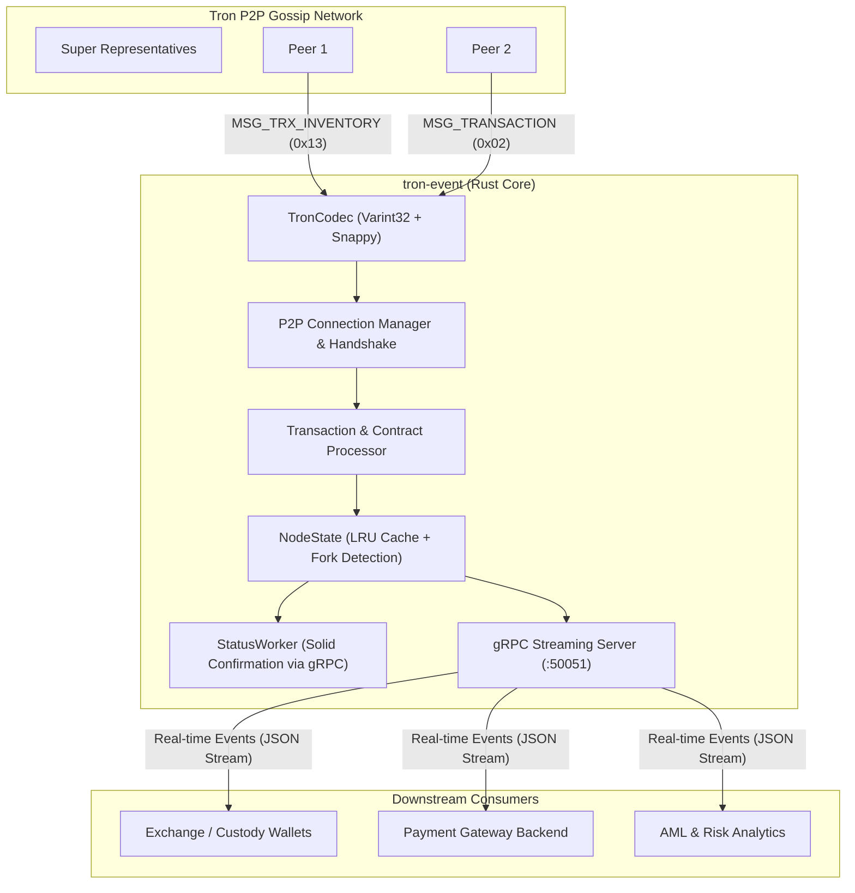

# Tron Event Node (tron-event)

> High-Performance, Zero-Latency Tron P2P Transaction Tracker & Event Processor in Rust.

[](https://www.rust-lang.org/)
[](#license)
[](#grpc-subscription-api)

**tron-event** is an ultra-low latency, autonomous Tron network sub-node and transaction monitoring engine written in Rust. By establishing direct connections to Tron Mainnet/Testnet peers via the native Tron P2P gossip protocol, it intercepts transactions directly in the **Mempool** seconds before they are included into a block, delivering instant event streams over gRPC.

---

## Table of Contents

- [Why Tron Event Node?](#why-tron-event-node)
- [Architecture & Key Features](#architecture--key-features)
  - [1. Zero-Latency P2P Mempool Ingestion](#1-zero-latency-p2p-mempool-ingestion)
  - [2. Hybrid Tracking Pipeline & Lifecycle States](#2-hybrid-tracking-pipeline--lifecycle-states)
  - [3. Fork Detection & Re-org Protection](#3-fork-detection--re-org-protection)
  - [4. Real-time gRPC Event Streaming](#4-real-time-grpc-event-streaming)
  - [5. Lite Node Compatibility](#5-lite-node-compatibility)
- [Project Layout](#project-layout)
- [Prerequisites](#prerequisites)
- [Configuration](#configuration)
- [Building & Running](#building--running)
- [Capacity & Resource Usage](#capacity--resource-usage)
  - [Measured footprint by subscription count](#measured-footprint-by-subscription-count)
  - [Recommended sizing](#recommended-sizing)
  - [Event throughput](#event-throughput)
- [gRPC Subscription API](#grpc-subscription-api)
  - [Protobuf Service](#protobuf-service)
  - [Event Schema](#event-schema)
- [Client Integration Examples](#client-integration-examples)
  - [Rust Client](#rust-client)
  - [Node.js Client](#nodejs-client)
- [Architecture Deep Dives](#architecture-deep-dives)
- [License](#license)

---

## Why Tron Event Node?

Traditional crypto services (exchanges, payment processors, automated bots, and custody providers) monitor incoming Tron (TRX) and TRC20 (USDT) transfers by periodically polling a FullNode via HTTP or gRPC (`GetTransactionInfoById`).

This approach introduces significant operational drawbacks:
1. **High Latency (3–10+ seconds delay)**: Transactions are only recognized after a block is produced, making early user feedback impossible and opening windows for transaction front-running or delayed processing.
2. **High Server Overhead**: Frequent polling creates substantial CPU and I/O load on RPC nodes.
3. **Mempool Blindness**: Official node APIs prune or throttle unconfirmed mempool queries, hiding pending double-spend attempts, gas fee adjustments, or rapid bridge deposits.

### Comparison: Standard gRPC Polling vs. tron-event

| Feature | Standard FullNode Polling | tron-event (P2P + Rust) |
| :--- | :--- | :--- |
| **Detection Speed** | Slow (Only after block confirmation: 3–10s) | **Instant (Zero latency: < 100ms from peer gossip broadcast)** |
| **Node Load** | High (Continuous active HTTP/gRPC polling) | **Zero (Nodes treat this client as a regular peer, pushing updates)** |
| **Data Scope** | Filtered API JSON structures | **Raw Protobuf (All contracts, calldata, and metadata intact)** |
| **Lifecycle Visibility** | `MINED` only | **Full Lifecycle (`PENDING_MEMPOOL` → `MINED` → `SOLID`)** |
| **Re-org Safety** | Manual block depth validation required | **Built-in automated Fork Detection & rolling state rollback** |
| **Memory & CPU Footprint** | Gigabytes of LevelDB storage and RAM | **Ultra-lightweight (< 50MB RAM, single-core async processing)** |

---

## Architecture & Key Features



### 1. Zero-Latency P2P Mempool Ingestion
- Implements the complete Tron dual-layer handshake (`LIBP2P_HELLO` `0xfd` and `P2P_HELLO` `0x20`).
- Transparently decodes Google Snappy compressed frames (`CompressMessage`).
- Fast decoding of core protocol messages: `MSG_TRX_INVENTORY` (`0x13`), `MSG_FETCH_INV_DATA` (`0x07`), and `MSG_TRANSACTION` (`0x02`).
- Parses native contract operations:
  - `TransferContract` (TRX Transfers)
  - `TriggerSmartContract` (TRC20 Token Transfers, specifically USDT `0xa9059cbb`)
  - `FreezeBalanceV2Contract`, `UnfreezeBalanceV2Contract`, `DelegateResourceContract`

### 2. Hybrid Tracking Pipeline & Lifecycle States
Every detected transaction progresses through a verified lifecycle:
- `PENDING_MEMPOOL`: Broadcasted by a peer, floating in the network mempool.
- `MINED`: Sealed inside a mined block on the blockchain.
- `SOLID`: Confirmed 19+ blocks deep by Super Representatives on the canonical chain. Irreversible and cryptographically final.

### 3. Fork Detection & Re-org Protection
In DPoS networks, short forks (1–2 blocks) occasionally occur when two Super Representatives produce blocks concurrently. 
- The node maintains a rolling window of recent block headers (Number, Hash, Parent Hash).
- If an alternative branch emerges, the node automatically calculates the common ancestor, rolls back orphaned transactions, and switches to the canonical chain.

### 4. Real-time gRPC Event Streaming
- Downstream services register interest via the bidirectional `NodeApi.Subscribe` stream.
- Supports **dynamic address filtering**: add or remove monitored addresses on the fly without restarting or dropping the connection.
- High-efficiency Zero-Copy event distribution with minimal latency.

### 5. Lite Node Compatibility
Does not require transaction history indexing or multi-gigabyte LevelDB archives. Operates seamlessly alongside Lite FullNodes or remote public gRPC endpoints.

---

## Project Layout

```text
tron-event/
├── Cargo.toml                    # Root workspace configuration
├── .gitignore                    # Comprehensive exclusion rules (no secrets/debugs)
├── main_net_config.conf          # Reference Tron Mainnet configuration
├── test_net_config.conf          # Reference Tron Testnet configuration
├── examples/                     # Standalone client examples & load-test tool
│   ├── README.md                 # Examples guide and benchmark instructions
│   ├── rust/                     # Rust subscriber example + load_test binary
│   └── js/                       # Node.js gRPC streaming client
├── scripts/
│   └── probe_seeds.py            # Seed-node reachability / handshake prober
└── rust-node/                    # Core Rust implementation
    ├── Cargo.toml                # Rust dependencies & build settings
    ├── build.rs                  # Protobuf compilation (tonic-build + prost-build)
    ├── .env.example              # Sample environment configuration
    ├── proto/                    # Protocol Buffers definitions
    │   ├── node_api.proto        # Internal gRPC Subscription API schema
    │   ├── core/                 # Tron core proto files
    │   └── tron/                 # Upstream Tron protocol definitions
    ├── docs/                     # Deep-dive architecture specifications
    │   ├── api.md                # gRPC API documentation
    │   ├── p2p_architecture.md   # Zero-copy gossip protocol architecture
    │   ├── p2p_handshake_protocol.md # OpCode table and framing specification
    │   └── fork_detection.md     # Re-org handling and Solidity confirmation
    └── src/
        ├── main.rs               # Node entrypoint and orchestration
        ├── lib.rs                # Library exports
        ├── config.rs             # Environment and runtime configuration
        ├── state.rs              # Concurrent node state and fork-detection engine
        ├── protocol.rs           # Generated Protobuf bindings
        ├── logging.rs            # Tracing and diagnostic logging
        ├── error.rs              # Error types
        ├── seed_nodes.rs         # Built-in public Tron Mainnet seed node registry
        ├── api.rs                # gRPC Server implementation (NodeApi)
        ├── net/
        │   ├── codec.rs          # Varint32 framing & Snappy compression engine
        │   ├── message.rs        # P2P Message abstractions
        │   └── mod.rs
        ├── p2p/
        │   ├── handlers.rs       # Inbound / Outbound packet handlers
        │   ├── status_worker.rs  # Confirmation & Solidity worker
        │   ├── tx_processor.rs   # Protobuf transaction and TRC20 decoder
        │   ├── utils.rs          # Cryptographic hashing and address formatting
        │   └── mod.rs
        └── bin/
            ├── test_client.rs    # CLI client for address monitoring
            ├── test_usdt.rs      # USDT-specific monitoring client
            ├── test_snappy.rs    # Snappy decompressor verification
            └── decode_hello.rs   # Handshake packet analysis tool
```

---

## Prerequisites

- **Rust**: Version 1.75+ (with `cargo`)
- **Protocol Buffers**: `protoc` (managed automatically via `protoc-bin-vendored` during `cargo build`)
- **Node.js** (optional, for running JS consumer examples): Version 18+

---

## Configuration

Copy the example environment file and adjust your settings:

```bash
cp rust-node/.env.example rust-node/.env
```

### Environment Variables

| Variable | Default Value | Description |
| :--- | :--- | :--- |
| `NETWORK` | `mainnet` | Target network (`mainnet` or `testnet`) |
| `P2P_VERSION` | `11111` | Tron P2P network magic version |
| `GENESIS_BLOCK_HASH` | `0000000000000000de1aa88295e1fcf9...` | Genesis hash for peer handshake validation |
| `NODE_ID` | Auto-generated 64-byte hex | Unique cryptographic identity for this P2P node |
| `EXTERNAL_IP` | `127.0.0.1` | Your public/external IP announced to peers |
| `GRPC_LISTEN_ADDR` | `0.0.0.0:50051` | Bind address for the internal gRPC subscription API |
| `NODE_GRPC_URL` | `tron.coinductor.io:50051` | Upstream FullNode gRPC endpoint for Solidity confirmation |
| `SEED_NODES` | Built-in seed list | Optional comma-separated custom peer IP:port list |

---

## Building & Running

### 1. Build the Project
From the repository root:
```bash
cargo build --release
```

### 2. Run the Node
```bash
cargo run --release -p rust-node
```

The node will initialize:
1. Start the internal gRPC event streaming server on `0.0.0.0:50051`.
2. Connect to active Tron P2P seed nodes and perform handshakes.
3. Launch the `StatusWorker` to verify block confirmations and monitor chain finality.
4. Stream incoming mempool and mined transactions in real time.

---

## Capacity & Resource Usage

The node keeps a set of subscribed addresses in memory and performs an O(1) hash lookup for every address mentioned by an incoming transaction. Memory therefore grows linearly with the number of tracked addresses, while CPU growth is driven by transaction volume rather than subscription count.

All figures below were measured with the bundled [`load_test`](examples/rust/src/bin/load_test.rs) benchmark against a live node connected to Tron Mainnet (5 peers, chain head advancing) on:

- **CPU**: AMD Ryzen 9 9950X (16 cores / 32 threads)
- **RAM**: 125 GiB
- **OS**: Linux 7.0
- **Build**: `cargo build --release` (default profile)

### Measured footprint by subscription count

| Subscribed addresses | Node RSS | Node CPU (steady state) | Registration throughput |
| ---: | ---: | ---: | ---: |
| 10,000 | 58 MB | 0.3 % | 17.4 M addr/s |
| 100,000 | 78 MB | 0.4 % | 23.9 M addr/s |
| 500,000 | 190 MB | 0.6 % | 28.7 M addr/s |
| 2,000,000 | 588 MB | 1.5 % | 1.4 M addr/s |

The marginal cost is roughly **270–300 bytes of RAM per tracked address**, on top of a ~40 MB baseline for the node itself. Address registration is batched (500 addresses per gRPC message), takes well under a second for 500k addresses, and does not block event delivery.

### Recommended sizing

| Deployment | Addresses | Suggested resources |
| :--- | ---: | :--- |
| Small / single-purpose service | up to 50,000 | 1 vCPU, 256 MB RAM |
| Typical payment or custody service | up to 500,000 | 1–2 vCPU, 512 MB RAM |
| Large exchange / indexer | up to 2,000,000 | 2 vCPU, 1 GB RAM |

**Comfortable limit:** around **500,000 addresses** on a 512 MB machine. Two million addresses still work but leave little headroom for burst traffic, fork buffers, and the OS page cache, so 1 GB is advisable at that scale. Beyond a few million addresses, shard subscriptions across several node instances — each instance maintains its own P2P connections.

### Event throughput

Because the node filters locally, subscription count has no measurable effect on event-handling cost; the bottleneck is the number of matching transactions on chain. Delivery itself is a streaming gRPC call with no polling, so latency stays in the low milliseconds from mempool gossip to client callback.

A 90-second run with **300 of the most active Mainnet addresses** subscribed delivered **3,598 events (≈40 events/s)**, about 1.1 MB of JSON, while the node process used **69 MB RSS and 2.3 % of one core**. Each transfer typically produces three events as it moves through its lifecycle (`PENDING_MEMPOOL` → `MINED` → `SOLID`), so this corresponds to roughly 1,200 distinct transactions in the window.

To reproduce these numbers, see the load-testing section of [`examples/README.md`](examples/README.md#load-testing).

---

## gRPC Subscription API

### Protobuf Service

```protobuf
syntax = "proto3";
package api;

service NodeApi {
  // Bidirectional stream: client submits address filters, server streams matching events
  rpc Subscribe (stream SubscriptionAction) returns (stream TransactionEvent);
}

message SubscriptionAction {
  enum Action {
    ADD = 0;
    REMOVE = 1;
  }
  Action action = 1;
  repeated string addresses = 2; // Hex or Base58 (e.g., TR7NHqjeKQxGTCi8q8ZY4pL8otSzgjLj6t)
}

message TransactionEvent {
  string transaction_json = 1; // JSON serialized transaction payload
}
```

### Event Schema

Each `TransactionEvent` carries a structured JSON payload:

```json
{
  "txid": "b3f09a8ec8930419c8491040319ca0194...",
  "type": "TRC20_TRANSFER",
  "status": "PENDING_MEMPOOL",
  "update_type": "NEW_TRANSACTION",
  "details": {
    "from": "TQrY8tryqsYVCYS3MFbtffiPp2ccyn4STm",
    "to": "TR7NHqjeKQxGTCi8q8ZY4pL8otSzgjLj6t",
    "amount": "100000000",
    "symbol": "USDT",
    "timestamp": 1713000000000
  }
}
```

When the transaction reaches finality on the main branch, a `STATUS_CHANGE` update is emitted:

```json
{
  "txid": "b3f09a8ec8930419c8491040319ca0194...",
  "type": "TRC20_TRANSFER",
  "status": "SOLID",
  "update_type": "STATUS_CHANGE",
  "details": {
    "from": "TQrY8tryqsYVCYS3MFbtffiPp2ccyn4STm",
    "to": "TR7NHqjeKQxGTCi8q8ZY4pL8otSzgjLj6t",
    "amount": "100000000",
    "symbol": "USDT",
    "timestamp": 1713000000000
  }
}
```

---

## Client Integration Examples

Ready-to-run clients live in the top-level [`examples/`](examples/) directory. Each one connects to `127.0.0.1:50051`, registers one or more Base58 addresses, and prints every matching event as JSON.

### Rust Client

```bash
cd examples/rust
cargo run --release -- TR7NHqjeKQxGTCi8q8ZY4pL8otSzgjLj6t
```

The same crate also builds `load_test`, the benchmark used for the capacity figures below.

### Node.js Client

```bash
cd examples/js
npm install
node index.js TR7NHqjeKQxGTCi8q8ZY4pL8otSzgjLj6t
```

```javascript
const grpc = require('@grpc/grpc-js');
const protoLoader = require('@grpc/proto-loader');
const path = require('path');

const PROTO_PATH = path.join(__dirname, '../../rust-node/proto/node_api.proto');
const packageDefinition = protoLoader.loadSync(PROTO_PATH, { keepCase: true });
const apiProto = grpc.loadPackageDefinition(packageDefinition).api;

const client = new apiProto.NodeApi('127.0.0.1:50051', grpc.credentials.createInsecure());
const stream = client.subscribe();

// Subscribe to addresses dynamically
stream.write({
  action: 'ADD',
  addresses: ['TR7NHqjeKQxGTCi8q8ZY4pL8otSzgjLj6t']
});

stream.on('data', (response) => {
  const event = JSON.parse(response.transaction_json);
  console.log(`[${event.status}] ${event.type}: ${event.txid}`);
});
```

See [`examples/README.md`](examples/README.md) for output formats, environment variables, and benchmark instructions.

---

## Architecture Deep Dives

For in-depth technical references and implementation notes, consult the documentation directory:
- [P2P Architecture](rust-node/docs/p2p_architecture.md): Zero-copy pipeline, gossip routing, and consensus certainty.
- [P2P Handshake Protocol](rust-node/docs/p2p_handshake_protocol.md): Varint32 framing, LibP2P capabilities, and OP Code registry.
- [Fork Detection & Re-orgs](rust-node/docs/fork_detection.md): Rolling header tree, ancestor discovery, and Solidity mechanics.
- [API Specification](rust-node/docs/api.md): Detailed gRPC interface definition and JSON structures.

---

## Security & Reliability

- **ECDSA Signature Validation**: All incoming P2P transactions are verified against the sender's cryptographic signature.
- **Snappy Guard**: Outbound and inbound packets respect byte-level length-prefixed Snappy compression envelopes.
- **Rate-Limiting & Staggered Outbound**: Connection manager staggers parallel node handshakes to prevent peer IP banning.
- **Autonomous Resiliency**: If a P2P peer disconnects, the connection pool automatically reconnects to healthy seed nodes.

---

## License

This project is licensed under the Apache-2.0 / MIT License. See [LICENSE](rust-node/proto/tron/LICENSE) for details.
