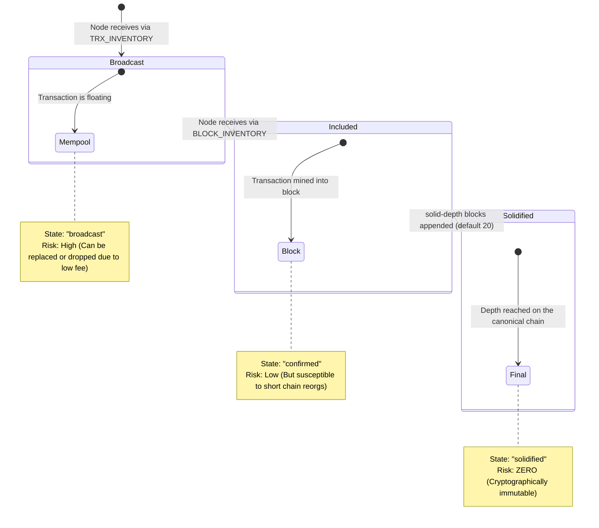

# Tron P2P Node Architecture

This document describes the operational principles of your Rust-based Tron Sub-Node, detailing how it interacts with the broader Tron network to ingest and broadcast data securely.

## 1. Zero-Copy Transactions Ingestion

The Tron network promulgates data via a "Gossip" mechanism. The process of your node obtaining real-time transactions is systematic:

1. **Inventory (`MSG_TRX_INVENTORY` | `0x13`)**: A connected peer broadcasts this packet. It contains a payload of transaction hashes (IDs) that are newly introduced to their Mempool.
2. **Fetch Data (`MSG_FETCH_INV_DATA` | `0x07`)**: Your node evaluates its internal LRU Cache matrix to ascertain if it has parsed these hashes before. If unrecognized, your node fires this payload back, formally requesting the raw protocol buffers.
3. **Receipt (`MSG_TRANSACTION` | `0x02`)**: In response, the peer streams down the complete, cryptographically signed raw byte code of the body of the transactions.
4. **Processing**: Inside `src/p2p/tx_processor.rs`, the parsing handlers unwrap the data mapping attributes like Sender, Recipient, Transfer Amounts, and Contract Calldata (for TRC20 operations), immediately streaming them onto internal Zero-Copy Tokió pub-sub channels.

## 2. Transaction Status and Data Reliability

A transaction lifecycle is not immediate. Logs and API responses specify a `"state"` field which represents network consensus certainty:



### Cryptographic Security & Anti-Spoofing

When accepting P2P data from random internet peers, your node validates authenticity mathematically without needing a centralized orchestrator:

- **Signatures**: Every `MSG_TRANSACTION` arrives bearing the ECDSA signature of the origin wallet. Manipulating quantities or recipient hashes intrinsically invalidates the signature.
- **Witness Endorsement**: Blocks (delivering `"confirmed"` statuses) are signed by *Witnesses (Super Representatives)*. The presence of specific witness signatures proves that core block producers acknowledge the ledger mutation.
- **Solidification Mapping**: The custom code natively protects against spoofing by linking the hashes sequentially. Unverified branches that misalign with the validated genesis chain are dropped.

> [!TIP]
> For highly critical financial operations (like user deposits), do not execute ledger updates strictly on `broadcast`. Read them in to provide UI feedback ("Payment pending..."), but only authorize backend credit when the system upgrades the payload to `confirmed` or `solidified`.

## 3. Emitting Signed Transactions

To propagate a local transaction over the ledger, you must forcefully announce it to your established peer topology:

1. **Serialization**: Wrap your signed parameters into `protocol::core::Transaction`.
2. **Broadcast Cycle**: Iterate through the `active_peers` map (Managed in `NodeState`) and dispatch a `write_message` command bearing your Transaction payload.
3. **Propagation**: If at least one "honest" peer receives your packet, authenticates its signature, and checks your fee availability, they will assimilate it and recursively Gossip it forward to the network.

**Internal Pipeline Logic:**
```rust
let my_tx = protocol::core::Transaction { /* populated struct */ }; 
for peer in state.active_peers.iter() {
    TronCodec::write_message(
        &mut writer, 
        &P2pMessage::TronTransaction(my_tx.clone()), 
        true, // Compresses via Snappy
        &peer.key()
    ).await?;
}
```

## 4. Current & Future Node Capabilities

### Operational Base System
- **Public Listening**: Actively listens on port `18888`, parsing and tracking incoming TCP connections universally.
- **Height Spoofing**: Simulates arbitrary genesis heights aggressively to ensure optimal data flow from network peers without incurring heavy sync overhead. Keepalive mechanism utilizes `TronPing` (`0x22`) exactly every 15 seconds.
- **Snappy Engine**: Instantly decompresses raw protobuf vectors wrapped in `CompressMessage` layers.

### Roadmap Additions
- **Deep Filtering Engine**: Ability to aggressively filter out all TRX operations below a certain threshold prior to passing them through the mpsc messaging pipeline.
- **Historic Block Downloader**: Add support to process full `MSG_BLOCK` packets specifically via `FETCH_BLOCK_HEADERS` requests, allowing you to establish a historical database pipeline without depending on third parties.
