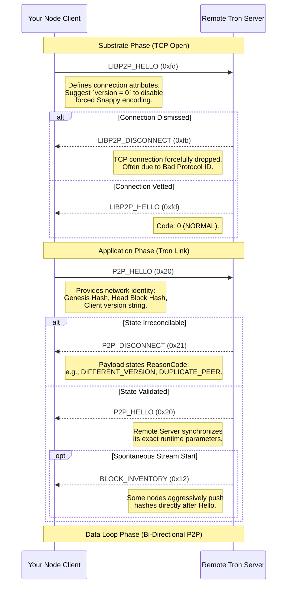

# Tron P2P Handshake Protocol & Command Packets

The Tron Network enforces a dual-layer TCP handshake protocol to successfully spin up a peer-to-peer connection. This document outlines the explicit connection flow and the specific message OP Codes required to navigate the distributed environment.

## 1. TCP Framing

At the bottom TCP socket layer, packets are delimited and encoded using a standard length-prefixer format: **Varint32**. This is followed by a single byte determining the Message OP Code, capping off with the raw serialized Protobuf payload.

```text
+-------------------+-----------------+----------------------------------+
| Length (Varint32) | OP Code (1 Byte)| Protobuf Payload (Length-1 Bytes)|
+-------------------+-----------------+----------------------------------+
```

> [!WARNING]
> The `Length` prefix represents the aggregate size of the **OP Code + Payload**. For buffer extraction algorithms, your target payload byte array size is always **`Length - 1`**.

## 2. The Dual-Layer Handshake

To reach "Trusted" status on the node graph, your inbound or outbound connection must satisfy both the preliminary **LibP2P Capabilities** handshake and the deeper **Tron Application State** handshake.

### Full Ecosystem Sequence Diagram



## 3. The "Snappy" Compression Trap

If a Client emits a `LIBP2P_HELLO` (`0xfd`) packet flagged with `version >= 1`, the opposing Java-Tron node immediately flags the socket as **Compression Upgraded**.

From that instant, **ALL subsequent packets** (including the baseline `P2P_HELLO` `0x20`) must be marshaled inside a `CompressMessage` protobuf envelope and processed through Google Snappy compression.

Failure to compress your frames will cause the Java-Tron node to throw an `InvalidProtocolBufferException` internally and slash the socket connection instantly.

**Solution**: Unless your application specifically marshals Snappy wrappers on outbound socket writes, ensure you always pass `version = 0` in the LibP2P stage.

---

## 4. Master OP Code Registry

Tron utilizes single-byte identifier mappings. Any packet successfully isolated from the socket stream must first be matched against these specific OP codes to determine how to deserialize the appended protobuf byte array.

| Hex Code | Integer | Message Name | Functionality |
| :---: | :---: | --- | --- |
| `0x01` | `1` | `TRX` | Broadcasts a full raw Transaction message. |
| `0x02` | `2` | `BLOCK` | Broadcasts a full raw Block message. |
| `0x03` | `3` | `TRXS` | Broadcasts an aggregated list of Transactions. |
| `0x04` | `4` | `BLOCKS` | Broadcasts an aggregated list of complete Blocks. |
| `0x05` | `5` | `BLOCKHEADERS` | Carries headers-only blocks, omitting memory-heavy payloads. |
| `0x06` | `6` | `INVENTORY` | General pipeline signal. Broadcasts lists of hashes (Items) the node just acquired. |
| `0x07` | `7` | `FETCH_INV_DATA` | Client directive: "I require the raw protobuf payloads matching these specific hashes." |
| `0x08` | `8` | `SYNC_BLOCK_CHAIN` | Sync request dictating the client's current block boundaries to the server. |
| `0x09` | `9` | `BLOCK_CHAIN_INVENTORY` | Server response to a Sync, charting a chronological series of block hashes required to catch up. |
| `0x10` | `16` | `ITEM_NOT_FOUND` | Notice indicating the server has pruned the requested hashes from memory. |
| `0x12` | `18` | `BLOCK_INVENTORY` | Explicitly advertises newly mined blocks. Often pushed over the wire automatically. |
| `0x13` | `19` | `TRX_INVENTORY` | Explicitly advertises newly instantiated pending Mempool transactions. |
| `0x20` | `32` | `P2P_HELLO` | The Primary Tron handshake. Governs validation parameters and chain boundaries. |
| `0x21` | `33` | `P2P_DISCONNECT` | Socket termination alert specifying the `ReasonCode` for the protocol break. |
| `0x22` | `34` | `P2P_PING` | Application-level Keep-Alive packet to prevent timeout reaping. |
| `0x23` | `35` | `P2P_PONG` | Mandatory acknowledgment to a Keep-Alive check. |
| `0x30` | `48` | `DISCOVER_PING` | UDP UDP Kademlia DHT node discovery check. |
| `0x33` | `51` | `DISCOVER_PEERS` | Network map response returning neighbor IP endpoints and Node IDs. |
| `0xfb` | `251` | `LIBP2P_DISCONNECT` | Lower-layer reject. Connection breaks due to faulty routing or blacklisting. |
| `0xfd` | `253` | `LIBP2P_HELLO` | Lower-layer initial handshake configuring connection flags (like Snappy routing). |

## 5. Organic Traffic Exchange Post-Handshake

After successfully settling into the Data Loop Phase, your stream will conform to general fetch mechanics.

### Synchronizing The Chain
1. Node A transmits `SYNC_BLOCK_CHAIN`
2. Node B computes diff, returning `BLOCK_CHAIN_INVENTORY`
3. Node A de-chunks inventory limits and dispatches sequential `FETCH_INV_DATA` bursts
4. Node B routes full `BLOCK` data until exhausted.

### Tapping Live Data Streams
1. Transacting Node pushes `TRX_INVENTORY`
2. Core Server scans internal maps, and subsequently mirrors the `TRX_INVENTORY` to connected clients
3. Subscribed APIs issue `FETCH_INV_DATA` targeting new hashes
4. Core Server blasts `TRX` instances directly through the socket stream.
